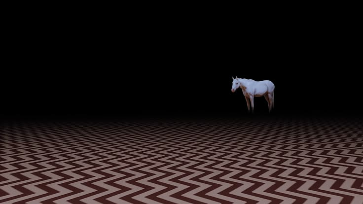

 

# $\color{#A64D5A}{\textsf{0-manda}}$

### $\color{#9D737C}{\textsf{The owls are not what they seem.}}$

$\color{#9D737C}{\textit{Somewhere between code, data and the unknown.}}$

 

---

### $\color{#A64D5A}{\textsf{01 / THE INVESTIGATOR}}$

Hello, I'm Amanda.

I'm a $\color{#A64D5A}{\textbf{Data Science \& Artificial Intelligence student}}$ interested in software development, Natural Language Processing and the ways technology can help us understand the world.

Currently working with $\color{#A64D5A}{\textbf{AI and NLP}}$, exploring language models, intelligent systems and the connections between data and human communication.

I enjoy learning by building things, investigating problems and finding unexpected connections along the way.

---

### $\color{#A64D5A}{\textsf{02 / THE TOOLS}}$

$\color{#9D737C}{\textbf{Languages}}$

$\color{#9D737C}{\textbf{AI \& Development}}$

---

### $\color{#A64D5A}{\textsf{03 / THE INVESTIGATION}}$

A collection of experiments, academic projects and things I build while trying to understand how they work.

**[Hemocentro](https://github.com/0-manda/Hemocentro)**

A web development and database project focused on creating an online blood center platform.

$\color{#9D737C}{\textit{More investigations coming soon...}}$

---

### $\color{#A64D5A}{\textsf{04 / ACTIVITY LOG}}$

---

$\color{#A64D5A}{\textit{"Is it future or is it past?"}}$

THE BLACK LODGE · 0-MANDA · EST. UNKNOWN

